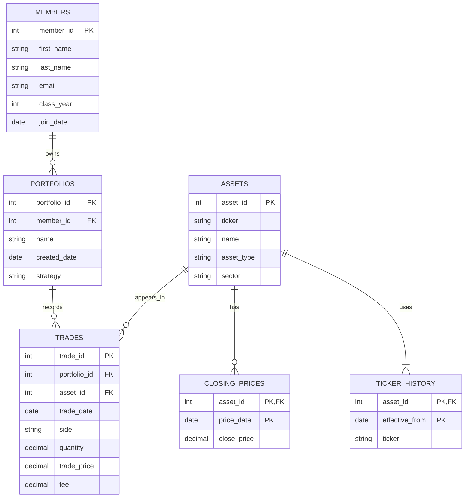

## 1. Scenario

I chose Scenario B, the investment club. The club wants to track what each member’s portfolios hold, when they buy and sell, and what their holdings are worth at the end of the day using closing prices. It also wants to keep track of ticker changes so it can follow the same asset over time. This would help the club review trading activity and compare portfolios.

## 2. ERD 

The first relationship to draw is: one member can own zero or more portfolios, and each portfolio belongs to exactly one member.

## 3. What One Row Means

| Table | What one row means |
| --- | --- |
| `MEMBERS` | One person in the club |
| `PORTFOLIOS` | One portfolio owned by one member |
| `ASSETS` | One investment that keeps the same ID even if its ticker changes |
| `TRADES` | One buy or sell of one asset in one portfolio on one date |
| `CLOSING_PRICES` | One asset’s closing price on one date |
| `TICKER_HISTORY` | One ticker for one asset, starting on the date it took effect |

## 4. Design Choices